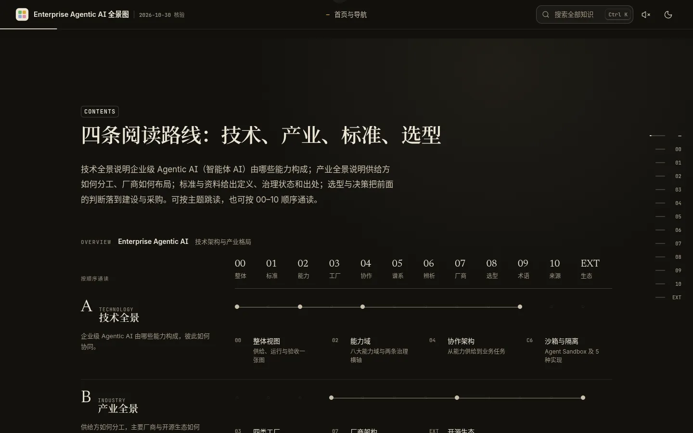
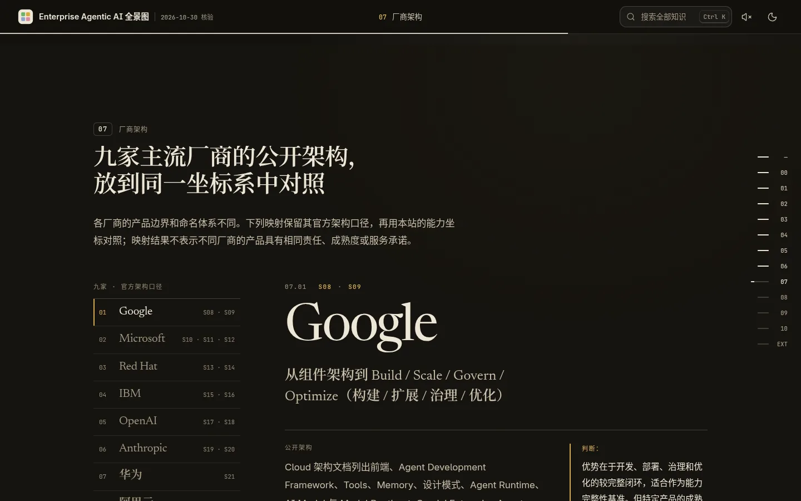
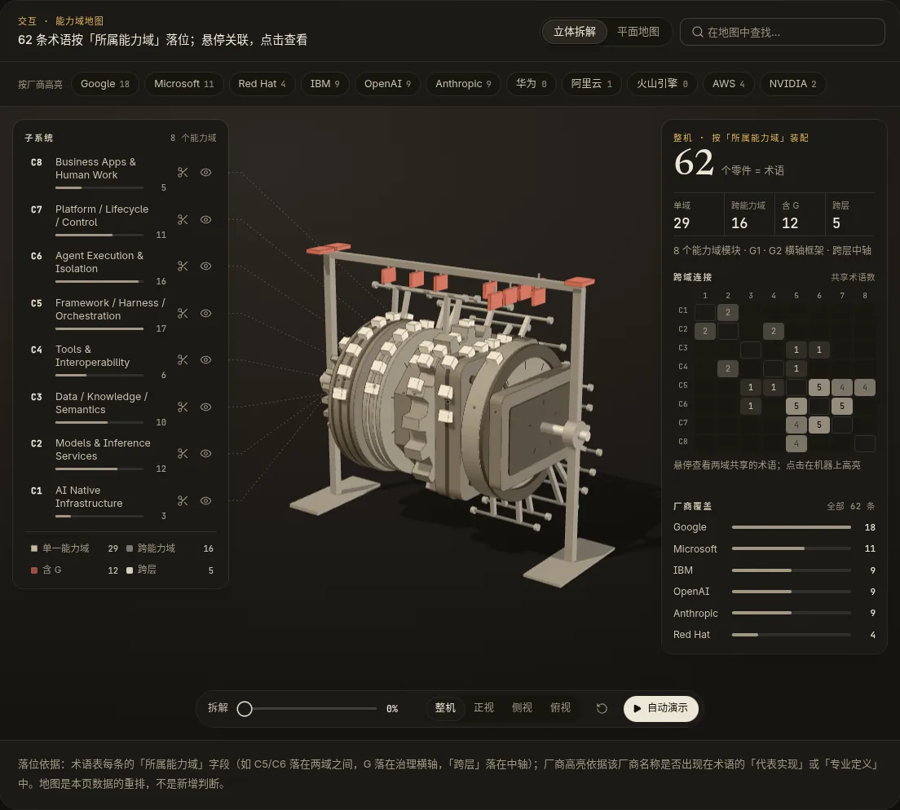

<div align="center">

# Enterprise Agentic AI 全景图

**梳理企业级智能体的技术架构与产业格局：由哪些能力构成、谁在制定标准、厂商如何布局、建设与选型看什么。<br>每项判断都注明出处与适用边界。**

[在线预览](https://breakdimbo.github.io/javascript-animation-skills/p-788ca6be612c54d9/EAI/) · [素材与许可](LICENSES.md)

</div>

<br>


## 概览

这是一个单页、纯静态的长文阅读站点，把企业级 Agentic AI 的研究内容组织成可交互的知识页面：
62 条术语、19 条术语谱系、33 条一手来源，九家主流厂商的公开架构放在同一坐标系中对照。

页面共 13 个分节：封面、导读（四条阅读路线：技术、产业、标准、选型），以及 00–10 十一个章节。

| 章节 | 主题 |
|---|---|
| 00 | 整体视图 |
| 01 | 标准：哪些已成标准，哪些仍是提案 |
| 02 | 八大能力域：各管什么、有哪些产品、常见误区 |
| 03 | 四类工厂：供给什么、谁买单、怎么衡量 |
| 04 | 协作架构：从能力供给到业务任务 |
| 05 | 术语谱系：谁提出、谁推动、谁在用 |
| 06 | 概念辨析：最常被混用的四组概念 |
| 07 | 厂商架构：九家主流厂商的公开架构对照 |
| 08 | 选型：先问业务需要哪些能力，再看平台 |
| 09 | 术语表：通俗解释、专业定义与边界 |
| 10 | 来源 |

文末另有一节延伸阅读（EXT）。

## 截图

<table>
  <tr>
    <td width="50%"></td>
    <td width="50%"></td>
  </tr>
  <tr>
    <td align="center"><sub>导读 · 四条阅读路线</sub></td>
    <td align="center"><sub>07 · 九家厂商的公开架构对照</sub></td>
  </tr>
</table>

<table>
  <tr>
    <td width="68%"></td>
    <td width="32%"></td>
  </tr>
  <tr>
    <td align="center"><sub>02 · 能力域地图「立体拆解」（three.js）</sub></td>
    <td align="center"><sub>移动端首屏 · 390 宽</sub></td>
  </tr>
</table>

<sub>截图由本地静态服务 + 无头 Chrome（SwiftShader 软件渲染）拍摄，桌面 1440 × 900，移动端 390 × 844 @2x。</sub>

## 亮点

- **13 个分节，一条叙事线。** 导读给出技术、产业、标准、选型四条阅读路线，可按主题跳读，也可按 00–10 顺序通读；右侧章节轨与顶部进度随滚动同步。
- **深色默认。** 首次绘制前就确定主题，不闪烁；只有手动切换过才会记住浅色。同时尊重 `prefers-reduced-motion`。
- **three.js 3D 能力域地图。** 62 条术语按「所属能力域」装配成一台可拆解的机器：拆解滑杆、正/侧/俯视、单个子系统隔离或隐藏、自动演示。3D 视图按需懒加载，平面地图始终保留，作为可访问的默认视图和 WebGL 不可用时的回退。
- **性能优化。**
  - 按需渲染：3D 场景只在可见且有变化时出帧，静止时不空转。
  - 着色器分片预热：支持 `KHR_parallel_shader_compile` 时用 `compileAsync`，否则在空闲时间里逐个对象预编译，避免第一次进入 3D 时集中链接造成长任务。
  - `content-visibility: auto`：离视口较远的区块跳过布局与绘制。
  - DPR 上限：WebGL 画布的像素比上限为 1.5。

  在 1440 × 900、DPR 1、SwiftShader 软件渲染下（单次测量，只适合看相对变化，绝对数值没有参考意义），第四轮相对第三轮：首屏指针交互 3 秒内的主线程耗时约降低 81%，GPU 进程耗时约降低 85%；首屏滚动帧率从约 35 fps 提升到 60 fps。

## 目录结构

```
.
├── index.html              页面本体（内容与结构）
├── LICENSES.md             第三方代码、字体与素材的来源和许可
├── assets/
│   ├── css/
│   │   ├── app.css         全局样式、主题与排版
│   │   └── sec-*.css       各分节样式（idx、thesis、01–10、ext）
│   ├── js/
│   │   ├── app.js          全局交互：主题、导航、搜索、地图与懒加载
│   │   ├── data.js         页面数据（术语、能力域、厂商、来源）
│   │   ├── sec-*.js        各分节交互
│   │   ├── map3d.js        3D 能力域地图（预构建，内含 three.js r180）
│   │   └── machine-assets.js  3D 场景用的 HDRI 与法线贴图（base64）
│   ├── fonts/              自托管并子集化的 woff2 字体
│   └── img/                页面配图
└── docs/screenshots/       README 用截图
```

## 本地运行

无需构建，任意静态文件服务即可：

```bash
git clone https://github.com/BreakDimbo/eai-redesign.git
cd eai-redesign
python3 -m http.server 8000
# 打开 http://localhost:8000/
```

请通过 HTTP 访问，不要直接双击打开 `index.html`：3D 地图的脚本按需加载，部分浏览器在 `file://` 下会拦截。

## 技术栈

- 原生 HTML / CSS / JavaScript，无框架、无运行时依赖、无构建步骤
- [three.js](https://github.com/mrdoob/three.js) r180（含 HDRLoader），打包在 `assets/js/map3d.js` 中
- [Lucide](https://lucide.dev) 图标，以内联 SVG 路径形式使用
- 自托管字体：Newsreader、Inter、JetBrains Mono、Noto Serif SC（均经子集化）
- WebAudio 实时合成的界面音效，默认关闭

## 素材与许可

第三方代码、字体、贴图的出处与许可逐项记录在 [LICENSES.md](LICENSES.md)：three.js 与 Lucide 分别为 MIT 与 ISC；字体均为 SIL Open Font License 1.1；3D 场景用的 HDRI 与纸张法线贴图为 CC0。

本仓库目前没有为页面自身的代码与文字单独声明许可。
